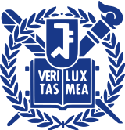

## Honors & Awards

- **1st Place, Berkeley AgentX–AgentBeats Competition, Phase 1 (Game Agent track)** - agentified Minecraft (MCU) benchmark, 2026 ([Link](https://rdi.berkeley.edu/agentx-agentbeats), [SNU CSE news](https://cse.snu.ac.kr/ko/community/news/1213))
- **1st Place (tie), Berkeley AgentX–AgentBeats Competition, Phase 2 (Game Agent track)** - VGI-Player, Minecraft purple agent, 2026 ([Link](https://rdi.berkeley.edu/agentx-agentbeats), [SNU CSE news](https://cse.snu.ac.kr/ko/community/news/1213))
- **Physics Expert Certification**
- **Academic Excellence Award** - Yonsei University, Spring 2021 and Spring 2025
- **Next-Generation Engineer Badge** - IPESK

## Research Experience

**[SNU Visual & Geometric Intelligence (VGI) Lab](https://jaesik.info/)**
Research Intern · 2025.10 – Current · Advisor: Prof. Jaesik Park

- System 1.5 VLA harness for Berkeley AgentBeats (1st place in both phases).
- Pre-trained and skill-tuned VLA policies for BEHAVIOR-1K; VLM-based belief-graph management.

**[Yonsei Multimedia AI (MMAI) Lab](https://mmai.yonsei.ac.kr/)**
Research Intern · 2025.12 – 2026.06 · Advisor: Prof. Jongyoo Kim

- CAD-free 6-DoF pose tracking with Hunyuan3D-generated object meshes.
- Probed MASt3R dense features for granularity-aware matching across large viewpoint changes.

**[SNU PI Lab](https://pi.snu.ac.kr/)**
Research Intern · 2025.03 – 2025.06 · Advisor: Prof. Youngjae Yu

- Sim-to-real robot navigation with vision-language-action models.
- Navigation waypoints from combined natural-language and sketch instructions.

## Education

**Yonsei University**
B.S. Electrical and Electronic Engineering · 2020.03 – 2027.02 (Expected)

## Projects

- **Efficient ResNet-34 Inference** - structural re-parameterization, distillation and quantization; 92% fewer MACs, 7× faster
- **Video-Based Vehicle Speed Estimation** - BiLSTM predicting ego speed from six consecutive KITTI frames
- **Deep Learning Reproductions** - 21 papers re-implemented (Grad-CAM, XOR-Net, …) with experiment reports
- **Reinforcement Learning Studies** - Q-learning, SAC, offline RL, model-based RL and RLHF, as technical reports

Full details in the <a href="/assets/files/CV_HyunguKim.pdf">CV</a>.

