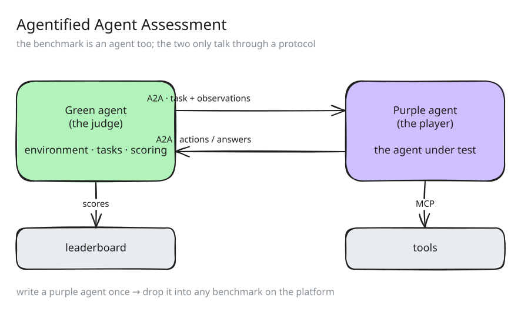
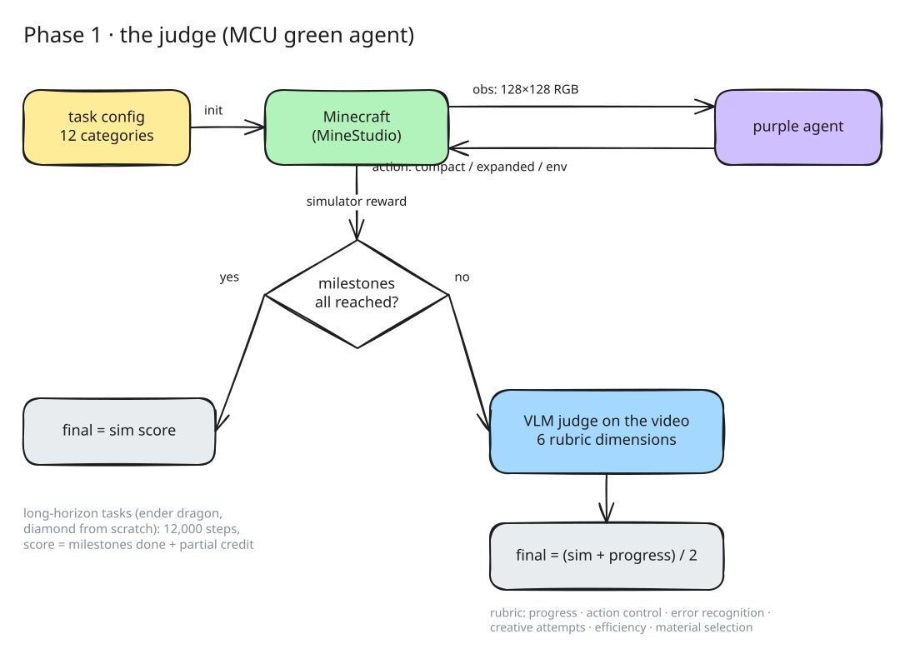
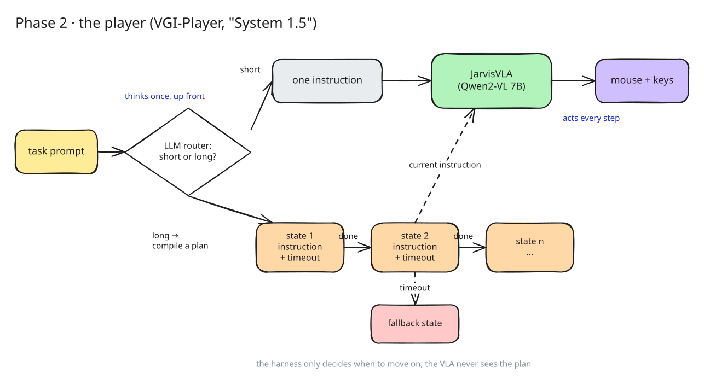

**tldr;** Over the AgentX–AgentBeats competition, our team sat on both sides of the table. In Phase 1 we turned the MCU Minecraft benchmark into a *green agent* (a judge), and in Phase 2 we built a *purple agent* (a player) that had to survive it. Both placed first. The thing I keep coming back to is how much of the player's competence came from a thin layer of structure *around* the model, not from the model itself.

## What AgentBeats actually is

Most agent benchmarks are a pile of tasks plus a script. You adapt your agent to the script, and the next benchmark makes you do it again. [AgentBeats](https://arxiv.org/abs/2606.13608) flips this around: the benchmark is itself an agent. A **green agent** owns the environment, the tasks and the scoring; a **purple agent** is the thing being evaluated; and the two only talk through a standard protocol (A2A for messages, MCP for tools). If your purple agent speaks the protocol once, it can in principle be dropped into any benchmark on the platform.

<figure><figcaption><b>Figure 1.</b> Agentified agent assessment. The judge is an agent, so the player only has to learn one interface. <a class="edit" href="/assets/diagrams/agentbeats-aaa.excalidraw" download>.excalidraw</a></figcaption></figure>

The [competition](https://rdi.berkeley.edu/agentx-agentbeats) ran in two phases. Phase 1 (Oct 2025 to Jan 2026) asked people to build green agents. Phase 2 (Mar to Jun 2026) asked people to build purple agents that do well on the best of them. We happened to do both on the same environment, which turned out to be a really nice way to learn about it.

## Grading Minecraft is harder than playing it

For Phase 1 we [agentified](https://github.com/guthsplan/MCU-AgentBeats) the MCU benchmark: Minecraft tasks across 12 categories (building, combat, crafting, mining, exploring, ...) plus two genuinely long-horizon ones, *mine a diamond from scratch* and *kill the ender dragon*, which get 12,000 steps instead of the usual 1,200.

The interesting part was not the plumbing (although there was a lot of plumbing). It was deciding what "doing well" means. A simulator reward is precise but narrow: it knows you picked up a log, it does not know you spent 900 steps staring at a wall first. A VLM judge watching the video is the opposite, broad but noisy. We ended up using both:

- if a task has simulator milestones, those come first, and the video judge is only called when the agent *didn't* max them out (cheaper, and the judge is only asked about the cases that are actually ambiguous);
- for long-horizon tasks, progress is milestones completed plus partial credit on the current one;
- the video rubric scores six things, including *error recognition* and *task efficiency*, which a reward function alone has no way to see.

<figure><figcaption><b>Figure 2.</b> How the Phase 1 judge scores a run. The (expensive, noisy) VLM judge only gets the ambiguous cases. <a class="edit" href="/assets/diagrams/agentbeats-judge.excalidraw" download>.excalidraw</a></figcaption></figure>

The other lesson was about the action interface. If you want *any* purple agent to plug in, you cannot assume it thinks in the same action space as yours, so the judge accepts a few equivalent formats (a compact bitmask + camera bin, an expanded button array, or the raw env format). It sounds like a detail. In practice it decides whether people can actually use your benchmark.

Writing a judge also made me much more suspicious of my own agents. Every scoring rule is a small claim about what progress looks like, and you only notice how arbitrary some of those claims are when you're the one writing them down.

## The player: a VLA with a little bit of System 2

For Phase 2 we started from [JarvisVLA](https://github.com/guthsplan/AgentBeats-JarvisVLA), a vision-language-action model for Minecraft that is good at what I'd call *single-instruction* control: give it "mine the oak log" and it will mostly go mine the oak log. What it is not built for is the 12,000-step version, where you need to remember that the log was for a crafting table, which was for a pickaxe, which was for the stone, and so on.

The obvious fix is to put a big planner on top that re-plans every few frames. We did something lighter, which we started calling **System 1.5**:

1. an LLM first *routes* the task: is this short-horizon or long-horizon?
2. short tasks go straight to the VLA as a single instruction, with no planning at all;
3. long tasks get compiled into a small **finite-state plan**: each state is one instruction the VLA can execute, plus a timeout and an explicit fallback state;
4. at run time, the current state's instruction is turned into actions by the VLA, and the harness only decides *when to move on*.

So the language model never touches the controls, and the VLA never has to know what the plan is. The harness in between is mostly bookkeeping.

<figure><figcaption><b>Figure 3.</b> VGI-Player. Thinking happens once, up front; the VLA acts every step; a small state machine decides when to move on. <a class="edit" href="/assets/diagrams/agentbeats-player.excalidraw" download>.excalidraw</a></figcaption></figure>

## Timeouts are a surprisingly good form of self-awareness

The part I underestimated was the timeouts. A VLA on its own has no notion of "this isn't working". It will keep trying the same thing with total confidence. A timeout plus a fallback state is a very crude version of that missing signal, but I believe it did a lot of the heavy lifting on long tasks: instead of the agent getting stuck, the harness gets bored and moves it along.

I later saw the same failure from the other side in the [BEHAVIOR Challenge](/blog/behavior-2026/), with a much larger VLA on a real-ish household robot: repeated grasp attempts, no notion of a failed subgoal, no recovery. Different domain, same missing piece. I don't think a bigger policy fixes this by itself. Something has to keep track of *where you are in the task*, and decide when the current attempt has failed.

## Where should the line between thinking and acting sit?

If I had to compress the whole competition into one question, it would be this. Our answer for AgentBeats was: thinking happens once, up front, as a plan; acting happens inside the VLA; and a dumb state machine connects them. That worked well enough to win, but it is clearly not the final shape. I see two directions:

- **push structure down into the policy**: give the VLA memory and an explicit belief over task state, so it can notice failure without a babysitter (this is roughly what our belief-graph supervision in BEHAVIOR was poking at);
- **push control up into code**: let the agent write the state machine, the checks and the controllers itself, i.e. code-as-policy, and only call the VLA for the parts that are actually hard to write down.

I'm honestly not sure which one wins, and the answer is probably "it depends on the task" (sorry). Figuring that out is roughly what I want to spend the next year on.

## Ending note

AgentBeats was fun precisely because it forced us to build the evaluator before the thing being evaluated. I'd recommend it to anyone who builds agents: writing the judge changes how you build the player.

### Acknowledgements

Thanks to my teammates at SNU VGI Lab, to Berkeley RDI and the AgentBeats organizers for running the competition, and to the CraftJarvis team for releasing JarvisVLA and the MCU benchmark.

### References

1. Liu et al. *AgentBeats: Agentifying Agent Assessment for Openness, Standardization, and Reproducibility.* [arXiv:2606.13608](https://arxiv.org/abs/2606.13608), 2026.
2. Berkeley RDI. [AgentX–AgentBeats Competition](https://rdi.berkeley.edu/agentx-agentbeats), 2025–2026.
3. Li et al. *JARVIS-VLA: Post-Training Large-Scale Vision Language Models to Play Visual Games with Keyboards and Mouse.* [arXiv:2503.16365](https://arxiv.org/abs/2503.16365), 2025.
4. Code: [MCU-AgentBeats](https://github.com/guthsplan/MCU-AgentBeats) (green agent), [AgentBeats-JarvisVLA](https://github.com/guthsplan/AgentBeats-JarvisVLA) (purple agent).
