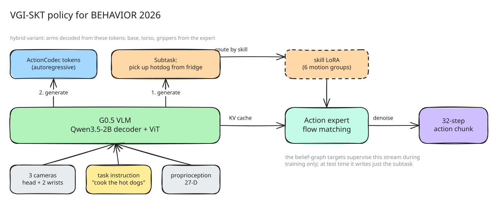
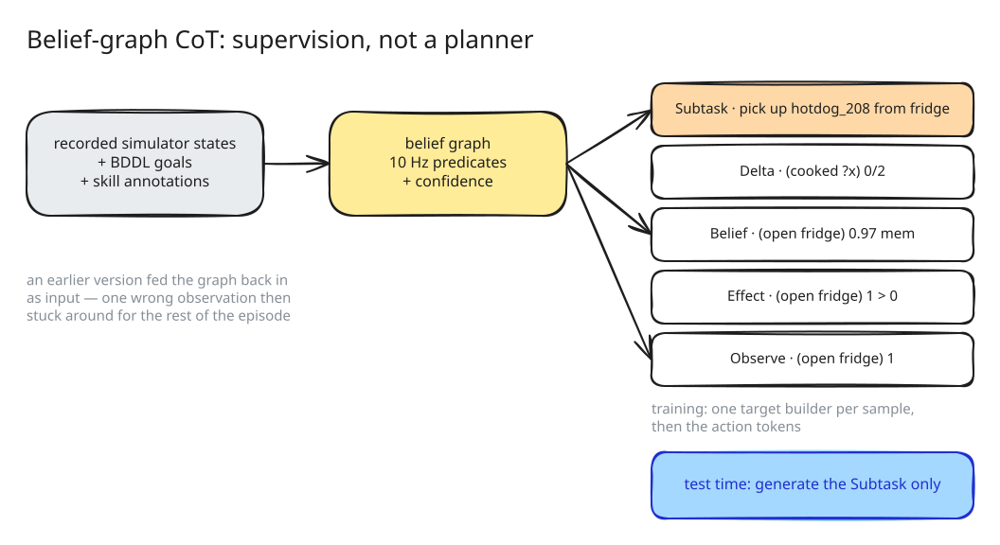
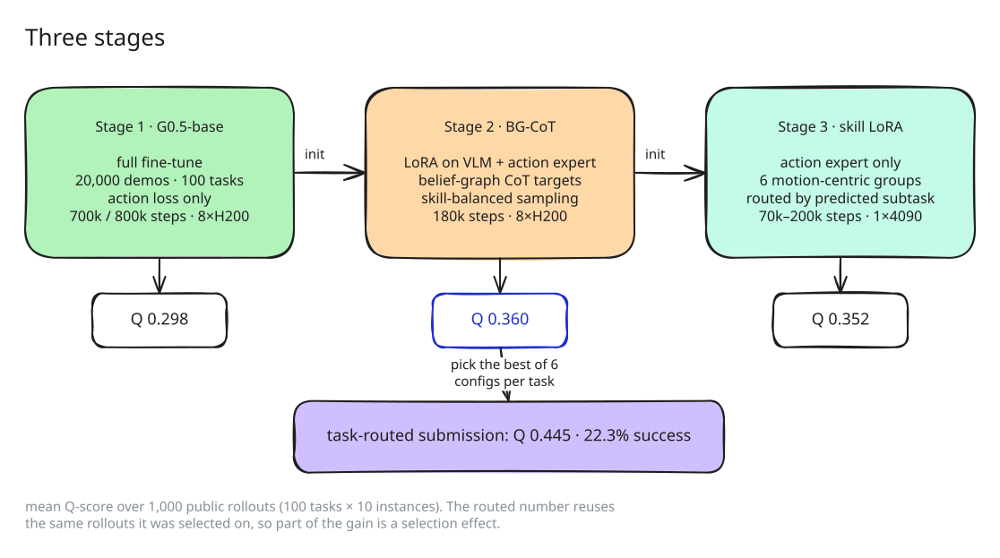

**tldr;** For the 2026 BEHAVIOR Challenge we adapted G0.5, a VLA that reasons and acts in one autoregressive stream, to 100 long-horizon household tasks. The thing that helped most was teaching the model to *describe the state of the task* (a belief graph) during training, without ever making it maintain one at test time. Our routed submission reaches a mean Q-score of 0.445 and 22.3% full-task success over 1,000 public rollouts, though part of that number is a selection effect, which I'll get to.

## The problem: long tasks, short memory

BEHAVIOR-1K puts a bimanual mobile robot (R1Pro) in simulated homes and asks it to do chores like *cook the hot dogs* or *put away the Halloween decorations*. The 2026 edition has 100 tasks across 7 scenes, with 200 teleoperated demonstrations each: 20,000 episodes, roughly 1,950 hours of 30 Hz data. A single episode can run for thousands of control steps, and the score (Q) is the fraction of goal conditions satisfied at the end.

What makes this hard is not any one motion. It is that the robot has to remember *where it is in the task*. A robot holding a hot dog before cooking it and after cooking it sees almost the same image, but should do completely different things next. A single camera frame often just doesn't contain that information.

<figure><figcaption><b>Figure 1.</b> Our policy. G0.5 writes a short subtask, which picks a skill adapter for the flow-matching action expert, which turns noise into a 32-step action chunk. <a class="edit" href="/assets/diagrams/b1k-overview.excalidraw" download>.excalidraw</a></figcaption></figure>

## Start boring

We started from G0.5, which already has the pieces we wanted: a Qwen3.5-2B backbone that can generate reasoning text and discrete action tokens in the same stream, plus a separate flow-matching *action expert* that reads the backbone's KV cache and produces continuous actions. Stage 1 was just fine-tuning it on all 20,000 demos with action supervision, on 8×H200.

Two lessons from this stage turned out to matter for everything after:

- **Offline validation loss is a bad compass.** In a five-task pilot, the checkpoint with the lowest validation error succeeded in 5 of 25 closed-loop rollouts; a later checkpoint with *worse* validation error got 7 of 25. So we stopped holding out data and picked checkpoints by actually running them, which is painful at roughly 12 minutes per rollout.
- **Commit to the whole chunk.** Executing all 32 predicted actions before replanning beat executing half of them in both comparisons we ran. Re-planning more often sounds safer, and wasn't.

## Belief graphs as supervision, not as input

Here is the idea I like most from this project. From the recorded simulator states, the BDDL goal definitions and the skill annotations, we can reconstruct a symbolic *belief graph* for every demo: which objects are open, inside, on top of, in hand, cooked; which goal conditions are already satisfied; what the next skill is supposed to change. We extracted it offline at 10 Hz over all 20,000 episodes (about 7 million target rows, 4.5 hours on 20 CPU processes).

Our first instinct was to feed that graph to the policy as input and have the model keep it updated at test time. In a closed-loop pilot, one wrong observation got written into the graph and then stayed there for the rest of the episode. The policy trusted its own memory more than its eyes.

So we flipped it: the belief graph only ever appears as a **training target**. For each sample, one "target builder" is drawn and the model has to write that field before its action tokens:

- **Subtask**: the current skill with its objects (*pick up hotdog_208 from fridge*);
- **Delta**: goal progress as counts (*cooked ?x 0/2*);
- **Belief**: predicate estimates with a confidence and whether they come from memory;
- **Effect**: what the current skill is expected to change;
- **Observe**: what is visible right now.

At test time the model only writes the subtask. The rest is there purely to shape what the backbone has to represent.

<figure><figcaption><b>Figure 2.</b> Belief-graph chain-of-thought: auxiliary targets during training, a one-line subtask at test time. <a class="edit" href="/assets/diagrams/b1k-bgcot.excalidraw" download>.excalidraw</a></figcaption></figure>

In a five-task pilot this lifted the mean Q-score from about 0.10 to 0.157. Across all 100 tasks, the BG-CoT model reached 0.360, up from 0.298 for the checkpoint it started from. I want to be careful with that second comparison: it also includes the sampler below and 180k more training steps, so it isn't a clean ablation of the CoT targets alone.

## Rare skills get starved

The demonstrations are wildly unbalanced across the 35 annotated skills. *Move to* is 38% of all frames; 26 skills are under 1% each, and *lift* has 293 frames in total. Under uniform frame sampling, short-but-hard skills like *insert* or *press* are barely trained.

We tempered the per-skill sampling distribution and raised a floor for rare skills, with a cap on how many times any single frame can be redrawn, so the floor doesn't turn into memorising the same 293 frames. In the pilot, mild tempering beat both no balancing and stronger tempering. Over the full run, the 18 up-weighted skills went from 2.2% to 8.4% of training samples.

## One expert per kind of motion

Driving across a room, grasping a small object and wiping a surface with a tool are very different motions for one action expert to cover. So we grouped the skills by motion (navigation, grasp, place, push/contact, tool use, in-place interaction) and trained a LoRA adapter on the action expert for each group. At inference, a deterministic parser maps the generated subtask to a group and swaps in that adapter, with no learned gate.

Honest result: averaged over 100 tasks, the adapters did *not* beat the shared expert (0.352 vs 0.360). But they were the best configuration on 35 individual tasks, which is why they still matter for the submission.

<figure><figcaption><b>Figure 3.</b> The three training stages and their mean Q-scores on all 100 tasks. <a class="edit" href="/assets/diagrams/b1k-stages.excalidraw" download>.excalidraw</a></figcaption></figure>

## A small detour: arms from tokens, the rest from flow

G0.5 can produce actions two ways: discrete ActionCodec tokens from the autoregressive decoder, or continuous chunks from the flow-matching expert. The token path has a quirk: when a gripper command stays constant for a whole chunk, its tokens are simply omitted, so in the *cook hot dogs* demos gripper tokens appear in only 1–3% of chunks. Pure token decoding left the base standing still and went 0 for 13 on *make microwave popcorn*.

So we tried a hybrid: arms from tokens, torso, base and grippers from the flow expert. In a pilot it went from 1 to 4 successes out of 25. On all 100 tasks it averaged lower (0.302), but again won on 10 specific tasks. Seeing this pattern for the second time, I've stopped thinking of these variants as "better" or "worse". They're good at different things.

## The number, and its asterisk

Since no single configuration was best everywhere, the submission picks one of six configurations per task based on its public results. Aggregated, that's a mean Q-score of **0.445** and **22.3%** full-task success (223 of 1,000 episodes), versus 0.360 and 15.1% for the best single configuration. Nine of ten rollouts succeed on *moving boxes to storage* and *putting dirty dishes in sink*. Only three tasks score zero.

The asterisk: the routing was chosen on the same public rollouts that the score is computed on. Part of that jump from 0.360 to 0.445 is a selection effect, and a clean estimate would need held-out instances. I'd rather say that out loud than have someone else point it out.

## What still fails

Looking through failed rollouts, the same things keep coming up, with or without CoT: repeated grasp and placement attempts, picking the hand that is badly placed for the object, collisions the robot never recovers from, and arm or torso posture slowly drifting until the head camera stares at the ceiling. None of the inference-time tricks we tried (temporal ensembling, subtask hysteresis, inpainting, bias correction) fixed these.

My read is that this is a data problem more than an inference problem: the demonstrations almost never show a robot noticing a failed grasp and trying again, so the policy has never seen what recovery looks like. Which loops back to the [AgentBeats](/blog/agentbeats/) lesson. Something has to know *where you are in the task* and *when the current attempt has failed*. Here we taught the model to describe the first; nobody has taught it the second yet.

## Ending note

The belief graph is the piece I'd keep. Using privileged simulator state as *supervision* rather than as *input* gave us most of the structure of a planner, without the failure mode of a planner that believes its own mistakes. Next, I'd like to see whether the predicted belief can actually drive subgoal recovery, and whether rejection-sampling fine-tuning or RL on the policy's own rollouts can fill in the missing recovery behaviour.

### Acknowledgements

This was a team effort by VGI-SKT (SNU Visual & Geometric Intelligence Lab and SK Telecom). Thanks to SK Telecom for compute, and to Chunfei Ma, Seungjun Lee and Joonhyang Choi for running the experiments on that infrastructure; to the BEHAVIOR organisers for the benchmark and evaluation; and to the G0.5 authors for releasing their model.

### Links

- Technical report: [PDF](/assets/files/vgi-skt-behavior-2026.pdf)
- Code: [github.com/guthsplan/behavior1k-2026-solution](https://github.com/guthsplan/behavior1k-2026-solution)
- Weights, Docker image and all 1,000 evaluation rollouts: [Hugging Face](https://huggingface.co/datasets/KWSMooBang/vgi-skt_behavior1k_challenge_2026_submission)
